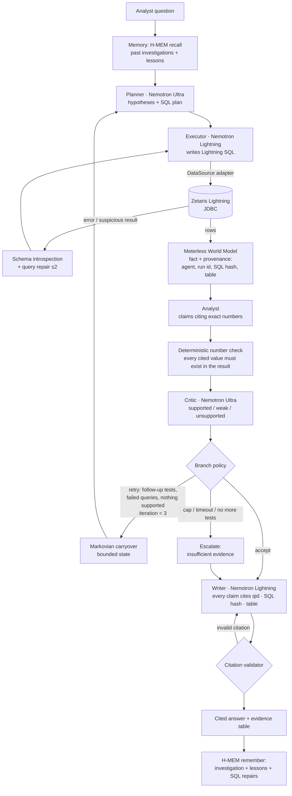

# WhyBot

**WhyBot tells you why a number moved, and shows the query behind every claim.**

A team of agents forms hypotheses, tests them with SQL that reads each source in place through Zetaris, rejects the ones the numbers don't support, and returns a recommendation where every claim cites its query id, SQL hash and source table.

Built for the GenAI Works **Open Agent Hackathon 2026, Track 2: "The Agent That Can Explain Why"**.

[](https://codespaces.new/Alexeiguch/whybot?quickstart=1)

**Try it in the [WhyBot Playground](PLAYGROUND.md):** open the Codespace above (no keys needed) or run `bash playground/run.sh` and go to http://localhost:7860. It replays the three recorded live runs with the agent timeline, Critic REJECT and RETRY, the SQL behind each claim (click a claim to see it), and a downloadable JSONL trace. Paste an NVIDIA key to run it live.

> **Status: hackathon submission (built from 22 Oct 2026).** End-to-end runs work against a **live local Zetaris 2.4.3.1** instance over JDBC, with Meterless memory and NVIDIA Nemotron. Real traces are in `logs/recorded-*.jsonl`, and recorded Zetaris results for `SAMPLE_MODE` are in `fixtures/recorded/`. See [Status and roadmap](#status-and-roadmap).

---

## The problem and the users

An operations analyst sees daily yellow taxi trips fall from between 130,018 and 153,149 on the other November 2024 Thursdays to 77,244 on Thursday 28 November 2024, and has to explain it by the next stand-up. Was it Thanksgiving, the 21.8 mm of rain, a change in trip mix, or missing data? Answering means querying trips, weather and a holiday calendar separately, lining them up by hand, and writing a summary nobody can audit.

WhyBot takes **one bounded question** about **NYC yellow-taxi trips + NOAA weather + US holidays**, each read in place through Zetaris Lightning SQL (overlap window 2024-04-01 to 2025-02-05). It returns:

- a short answer and a **recommendation**,
- **claims that each cite the evidence they rest on** (query id · SQL hash · source table),
- the hypotheses it **rejected**, with the reason for each,
- a full **JSONL trace** of every agent message, SQL statement, critic verdict, retry and escalation.

Users: operations analysts at taxi fleets, ride-hail operators and city transport teams who must explain a change in daily trips, and the managers who need an answer they can forward. The loop itself is metric-agnostic (see Status and roadmap).

## How it works



**Agents in one run**

| Agent | Model | Job |
|---|---|---|
| Planner | `nvidia/nemotron-3-ultra-550b-a55b` | Turns the question into falsifiable hypotheses (metric/H0, weather, holiday, day-of-week, fare mix, zone mix, data quality) and a SQL plan. Revises the plan from critic feedback and Markovian carryover. |
| Executor | `nvidia/nemotron-3.5-lightning-30b-a3b` | Writes Lightning SQL and runs it through the `DataSource` adapter (read-only guard, timeout). On an error **or a suspicious result** (such as a cross join that gives every row identical values) it re-introspects the schema and repairs the query, up to 2 times. If the query still fails, that hypothesis is marked untestable for the iteration. |
| Analyst | Lightning | Drafts claims for and against each hypothesis, citing exact values `{qid, column, value, row_hint}`. |
| Critic / Evaluator | Ultra | First, a **deterministic check** confirms every cited number appears in that query's rows, and re-evaluates every percentage or ratio in a claim from its declared formula over the cited cells. A small arithmetic slip by the model (within about 1%) is replaced by the recomputed value and logged as `arithmetic_corrected`, so the arithmetic comes from the evaluator rather than the model. A real mismatch is rejected, so "fell 49.5%" fails when the cells give 45.5%. A `row_hint` must be `<column>=<value>` on a returned column and match a row (it is required when the result has several rows that differ in the cited column); an invalid hint fails instead of falling back to all rows. A number never matches a string (boolean flags match across `True`/`1`/`Y`). The Analyst writes numbers as `{placeholders}` that the evaluator fills in, and a claim worded as a drop whose change is positive (or the reverse) is rejected. A comparison such as "higher than the other Mondays" is checked against the cited rows, so it fails when any other row has a higher value. Then the LLM critic judges strength, baseline fairness and confounders, sets each hypothesis's status, and decides **accept / retry (with follow-up tests) / insufficient_evidence**. The Critic also runs a deterministic **holiday data-quality check**: it compares `TPCDS_DB.date_dim.d_holiday` with the real Nager.Date holidays around the target date and reports any disagreement as a **data-quality note**, never as evidence. |
| Writer | Lightning | Writes the final answer from critic-approved claims. A validator rejects any citation whose qid, SQL hash or table doesn't match real evidence. It also rejects any number in the headline, answer, claims, recommendation or caveats that is not a query cell or a verified derived value; a percentage or multiple must match a derived value or a rate column of a query the answer may cite. It rejects a comparison contradicted by the cited rows, and any date that appears in no result, note or the question. Rejected drafts are retried with feedback. The calendar data-quality caveat is rendered deterministically from the DQ1 rows. As a last resort, a deterministic fallback renders the critic-verified claims verbatim with their citations. |

**Control flow is real branching, not a pipeline.** Critic verdicts and the number checks drive `checks.decide_next()`: *write*, *retry* (back to the Planner with feedback), or *escalate* to "insufficient evidence". Iterations are capped at 3, and every LLM call, SQL query and the whole run have timeouts. Every JSON output is validated against a pydantic schema and retried with the validation error. Nemotron reasoning content is stripped and never logged.

## Sponsor technology: where each piece fits

| Sponsor | Where it is used |
|---|---|
| **Zetaris** (required) | The only production data path. Every query an agent writes is Lightning SQL sent over JDBC (`whybot/datasource/zetaris_jdbc.py`: JayDeBeApi + `com.zetaris.lightning.jdbc.LightningDriver`, `jdbc:zetaris:lightning@localhost:10000`), and Zetaris reads each source **in place**, with no copies or ETL into WhyBot: real TLC yellow trips as S3 CSV (`NY_TAXI.yellow_taxi`, 38.7M rows, through the cached `whybot.yellow_daily` view), NOAA GHCN-Daily as public S3 CSV (`NOAA_GHCN_S3`), Nager.Date holidays as a live REST source (`HOLIDAYS_REST`), and the `TPCDS_DB.date_dim` Parquet calendar. The SchemaStore views live in container `whybot` (`sql/03_whybot_views_create.sql`). In the recorded runs the agents query each source separately and line the results up by date; `sql/10_federated_daily_select.sql` is a hand-written four-way federated query (taxi × weather × holidays × date_dim, about 17 s for a 62-day window) that shows the join works. No recorded run contains a successful agent-written cross-source join yet: run #2 tried one and gave up after 3 attempts (see Known issues). Schema introspection uses `DESCRIBE DATASOURCE TABLE`, falling back to `SELECT … LIMIT 1`. `SAMPLE_MODE` replays **recorded real Zetaris results** (`fixtures/recorded`), labelled **RECORDED** in the UI. |
| **Meterless** (required) | The cognition layer, through a JSON-lines bridge (`meterless_bridge/bridge.ts`, `whybot/memory.py`) to the Meterless TypeScript reference engines, vendored under `vendor/meterless` (Apache-2.0). **H-MEM:** past investigations, lessons and SQL-repair fixes are stored after each run and recalled for the Planner and SQL agent before planning (threshold tuned to 0.15 because the reference hashed embeddings score low). **World Model:** every successful query result, and every critic-supported claim, is asserted as a fact with provenance (`by` agent, `runId`, `checksum` = SQL hash, `url` = `zetaris://<table>`). **Markovian:** each loop iteration is one chunk, and its `[STATE_CHECKPOINT]` is compressed into a bounded carryover for the next Planner call. The finished investigation is recorded as a Markovian run. |
| **NVIDIA** | All reasoning runs on **Nemotron** through the OpenAI-compatible NVIDIA API (`https://integrate.api.nvidia.com/v1`). Ultra 550B handles planning and critique, and Lightning 30B handles SQL, analysis and writing. No local GPU is needed. |
| **Cursor** | The whole project was developed in Cursor (with Grok Bot agents). |

## Stack

Python 3.11+ (FastAPI, pydantic, openai client, JayDeBeApi), Node 20 (`tsx`, for the Meterless bridge), a Java 17+ JRE (for the Zetaris JDBC driver), and DuckDB (dev stand-in only).

## Setup

```bash
git clone https://github.com/Alexeiguch/whybot && cd whybot
python3 -m venv .venv && .venv/bin/pip install -r requirements.txt
(cd meterless_bridge && npm ci)          # Meterless bridge (Node 20+)
cp .env.example .env                       # fill NVIDIA_API_KEY and the ZETARIS_* values; never commit .env
```

For Zetaris you need a running instance (local Docker bundle from Zetaris Cloud, or a managed cluster) and its JDBC driver JAR. Set `ZETARIS_JDBC_JAR`, `ZETARIS_USERNAME` and `ZETARIS_PASSWORD`, then register the sources and views with the scripts in `sql/` (see `sql/00_README.md`, dry-run first). A Java runtime must be on the box (`JAVA_HOME`).

### Data the agents can see (evidence allowlist, `ZETARIS_TABLES`)

| Table | What it is |
|---|---|
| `whybot.yellow_daily` | Cached SchemaStore view over the real TLC yellow trips in `NY_TAXI.yellow_taxi` (38.7M rows): trips, avg_total_amount and avg_trip_distance per day, 2024-04-01 to 2025-02-28 |
| `whybot.nyc_weather_daily` | NOAA GHCN-Daily, Central Park USW00094728 (CC0): precipitation, snow and temperature per day, up to 2025-02-05 |
| `whybot.us_holidays` | Nager.Date US holidays 2024-2025 via the `HOLIDAYS_REST` REST source: the authoritative holiday evidence |
| `TPCDS_DB.date_dim` | Calendar (day names). Its `d_holiday` flag is **synthetic**, so it is used only by the Critic's data-quality cross-check |
| `NY_TAXI.taxi_zones` | Real TLC zone lookup |

The synthetic `NY_TAXI` tables (`trips`, `weather_data`, `surge_pricing`, `driver_shifts`, …) are excluded from evidence on purpose. Raw `NY_TAXI.yellow_taxi` is opt-in, because an uncached scan takes about 170 s.

## Run

```bash
# CLI: one investigation, JSON result on stdout, readable log on stderr, trace in logs/<run_id>.jsonl
.venv/bin/python run.py "Why did NYC yellow taxi trips drop on Thursday 28 Nov 2024 compared with the surrounding weeks?"
.venv/bin/python run.py --example input_examples/example_1.json --markdown

# API + web UI on 0.0.0.0:8000
.venv/bin/python run.py --serve
curl -X POST localhost:8000/run -H 'Content-Type: application/json' -d @input_examples/example_1.json
# open http://localhost:8000 : live agent timeline (SSE), evidence table, cited answer with clickable citations
```

API: `POST /run` (blocking, hackathon JSON shape), `POST /runs` + `GET /runs/{id}/events` (server-sent events), `GET /runs/{id}`, `GET /samples`, `GET /health`.

**Data source modes** (`DATA_SOURCE` / `SAMPLE_MODE`):

| Mode | What it is |
|---|---|
| `DATA_SOURCE=zetaris` (default) | Live Zetaris over JDBC. If Zetaris is unreachable and recorded fixtures exist, the run falls back to replay and says so in the trace. A live run takes about 5 to 13 minutes (291 s, 431 s and 752 s in the recorded runs), within the run budget `RUN_TIMEOUT_S=900`. The last 150 s of the budget are reserved for the Writer, and every Nemotron call has a hard watchdog. The wall-clock time is recorded in each trace's `finish` event and in `result.wall_clock`. |
| `SAMPLE_MODE=true` | Replays a **recorded live run**: real Zetaris query results from `fixtures/recorded/queries` and the Nemotron responses of that same run from `fixtures/recorded/llm`. Works fully offline, no credentials. See [What SAMPLE_MODE is](#what-sample_mode-is). |
| `DATA_SOURCE=dev` | **DEV-ONLY** DuckDB over a small public Jan-Feb 2024 sample (`scripts/fetch_dev_data.py`), used before Zetaris was up. It is not Zetaris, is shown with a red banner in the UI, and is never used for the demo. |

### What SAMPLE_MODE is

SAMPLE_MODE is a faithful replay of one real investigation, not a hard-coded answer.

- **What is replayed:** the SQL results (each recorded from live Zetaris and keyed by the SQL hash of the exact statement) and the LLM responses (recorded in order per agent from the live Nemotron calls). Every recorded call keeps its model, original latency, token counts, `recorded_at`, a hash of the prompt that was sent, and the id of the live run. That run's full live trace is committed at `logs/recorded-<run_id>.jsonl`.
- **What re-executes:** the orchestration itself. SQL guarding and hashing, result-sanity checks, the deterministic number and derived-value checks, the branch policy (retry, write or escalate), the Writer's citation validator, and trace writing all run again. Each replayed LLM call reports `prompt_match`, which says whether today's prompt hashes to the one sent live, so any drift since recording is visible rather than hidden. A mismatch emits a `replay_drift` warning event and a **DRIFT: prompt changed since recording** badge in the Playground; `REPLAY_STRICT=true` makes a drifted replay fail instead.
- **Versioned checks:** the deterministic checks carry a version (`CHECKS_VERSION` in `whybot/checks.py`, now 2), and each new cassette stores the version it ran with. A replay runs the checks at the cassette's version (1 for the three committed samples), because a stricter check changes the feedback sent to the agents and so the prompts. It also runs the current checks over the same claims and drafts and reports anything extra in one `shadow_checks` warning event before `finish`; for the committed samples that is run #3 (see Known issues). A live run always uses the current checks.
- **How it is labelled:** the trace opens with an `Orchestrator.llm_mode` event naming the live run and its trace. The UI shows a yellow "REPLAY of live run … recorded at …" banner, and every evidence row carries "RECORDED zetaris results".
- **How to see it live instead:** `SAMPLE_LLM=live` makes live Nemotron calls against the recorded SQL results, and `DATA_SOURCE=zetaris` without SAMPLE_MODE runs everything live.

**Docker**

```bash
docker build -t whybot .
docker run --rm -p 8000:8000 --env-file .env whybot          # live Zetaris: also mount the driver JAR and set ZETARIS_JDBC_JAR
docker run --rm -p 8000:8000 -e SAMPLE_MODE=true whybot       # recorded replay, no credentials
```

## Sample questions

1. `input_examples/example_1.json` (**headline demo**): *Why did NYC yellow taxi trips drop on Thursday 28 Nov 2024 compared with the surrounding weeks?*
2. `input_examples/example_2.json`: *Did the snowfall on Saturday 21 Dec 2024 reduce NYC yellow taxi trips compared with the other Saturdays in December 2024, and why?*
3. `input_examples/example_3.json`: *Why did the average total amount per yellow taxi trip jump on Monday 20 Jan 2025 compared with the other Mondays in January 2025?*

### Recorded live runs (live Zetaris + NVIDIA Nemotron + Meterless)

| # | Result | Live wall clock | What happened |
|---|---|---|---|
| 1 | **answered**: "NYC yellow taxi trips dropped 45.5% on Thanksgiving Thursday 28 Nov 2024" | 291 s, 1 iteration | 77,244 trips against a mean of 141,603 on the other November 2024 Thursdays, The answer names Thanksgiving and the 21.8 mm of rain; a caveat notes that 21 Nov had more rain (39.9 mm) without as steep a drop, suggesting the holiday effect dominates. The Critic rejected the one holiday claim (c2, seq 41 and 49) because it cited baseline rows the query never returned. Average fare fell to $25.32 and average distance rose, a shift in trip mix. The `d_holiday` data-quality caveat is rendered from DQ1, and no claim says the weather was mild or that there were no data-quality flags. |
| 2 | **answered**: "Saturday 21 Dec 2024 taxi trips were essentially unchanged despite heavy snowfall" | 431 s, 2 iterations | **Critic REJECT → retry → changed answer.** At trace seq 77 the Critic rejects the claim that the 46 mm of snow "suppressed taxi demand", because H0 shows +0.15%. Seq 80 branches back to the Planner, and the iteration-2 answer reports no drop against the mean of the other three December Saturdays (one of them, 28 Dec, is the Saturday after Christmas; the answer's caveat says the comparison set matters). |
| 3 | **insufficient_evidence**: "Average fare jumped 36.5% on MLK Day, but root cause remains unclear" | 752 s, 3 iterations | The jump and the holiday are confirmed. Weather and distance-mix claims are judged weak in iteration 3 (seq 109 and 110), and zone mix cannot be tested on the daily view, so the run escalates honestly. **H-MEM recall** (seq 6) returns 5 memories from the sample #2 investigation (top relevance 0.286). |

All three samples were recorded live against Zetaris, in the order #2, #3, #1, sharing one Meterless store, so the later runs' recall of earlier ones is real. They were not all recorded on the same code (times are London time, 22 Oct 2026):

- **#2** (15:09 to 15:15) and **#3** (15:16 to 15:28) ran on commit `a1b87ff`; the recordings were committed as `7d4b09b` and `b3e7676`.
- **#1** (19:01 to 19:04) ran on the working tree that was then committed as `24ed78c` and `0dd88ee`; the recording was committed as `1a9a73c`.
- After recording, the fixtures of #2 and #3 were normalised by repo scripts, without changing any data value: `scripts/backfill_recorded_errors.py` copied the live Zetaris error text of failed queries from each committed trace into `fixtures/recorded/queries` (so replayed SQL-repair prompts match), and `scripts/normalise_recorded_rows.py` re-fetched every fixture from live Zetaris and rewrote the two whose boolean column had been stored as 1 instead of true. The live H-MEM recall of each run was copied from its trace into the cassette (`hmem_recall`). All of this is in commit `0dd88ee`.

Replayed on the current code, every LLM call hashes to the same prompt as the live call (`prompt_match` is true for all of them). `SAMPLE_MODE` replays of all three take under 1 s each and reproduce the same headline and answer (`tests/test_sample_mode_e2e.py`).

`output_examples/` holds the full JSON results of these runs and `logs/recorded-*.jsonl` their traces. `docs/dev-only/` holds one early trace from the DEV-ONLY DuckDB stand-in; it is not a sample and is not replayable (see its README).

### Known issues

- **Run #3, claim 4.** The final answer states that the 4.79-mile average distance on 20 Jan was higher than on the other three Mondays, which its own cited query Q6 contradicts (13 Jan was 5.53). The Critic judged the underlying claim weak (seq 110) rather than rejecting it, and the Writer's validator at the time checked that numbers trace to cells, not comparisons between them. The comparison check added since then rejects this claim; replaying run #3 reports it as a `shadow_checks` finding (see What SAMPLE_MODE is), and the recorded answer is left as it was recorded.
- **Run #3, "12%".** The Writer's first draft wrote "12%", which the old check matched to an unrelated cell (LocationID 12). The current percentage check rejects it; the replay reports this as a `shadow_checks` finding too.
- **Run #1, holiday claim.** The answer says the drop was driven by Thanksgiving and the weather, but the one holiday claim (c2) was rejected because it cited null values for baseline dates the query never returned (the Analyst prompt asks for absence to be cited with a COUNT = 0 cell or in words). The Writer's validator checks numbers, dates and citations, not whether every named cause has a supported claim.
- **Cross-source joins.** Run #2's attempt at an agent-written join of `whybot.yellow_daily` with `TPCDS_DB.date_dim` failed three times: the repairs invented a `d_date_sk` column on `yellow_daily` instead of joining `trip_date = d_date`. The likely fix is join-key hints in `whybot/catalog_notes.json`; it changes the agents' prompts, so it needs the samples re-recorded.

## Demo video

[TBD: link to the 1-4 minute demo video]

## Logs and traces

Each run writes `logs/<run_id>.jsonl`, one event per line: `timestamp, run_id, seq, iteration, agent_name, action, input_summary, output_summary, target_agent, status, retry_count, confidence, data`. Events cover the plan, every SQL statement with its hash, query results, failures, schema introspection and repairs, result-sanity rejections, number checks, critic verdicts, branch decisions, Markovian carryover, World Model fact ids, H-MEM recall and remember, the final answer, and escalations. It also writes `logs/<run_id>.result.json`. Secrets are redacted before anything is written.

## Tests

```bash
.venv/bin/python -m pytest -q
```

The tests use a scripted fake LLM and a fake data source, with no network: 123 tests, 107 in `tests/` and 16 in `playground/tests/`. They include an end-to-end SAMPLE_MODE replay of each of the three committed live recordings, which must reproduce the live headline and answer with a real Writer answer and no fallback, and a check that at least one recorded run contains a Critic reject followed by a retry. They cover the number checks (including derived percentages and ratios), every branch of the decision policy (accept, retry, cap, early escalation, timeout), SQL repair, then critic retry, then accept; escalation after 3 iterations; Writer citation retry; query fallback; planner catalog validation; the SQL guard (single read-only statement, forbidden functions such as `reflect`/`java_method`, and the table allowlist enforced on the executed SQL); value matching without prefix or loose-rounding matches; every number and date in the final headline and answer traced to evidence; the direction-of-change and comparison checks; percentage scoping to cited evidence (including the recommendation and caveats); strict `row_hint`s; date-bound weather wording; versioned checks with shadow findings and replay drift warnings (and `REPLAY_STRICT`); the sqlglot table allowlist and the 500-row cap; reserved `recorded-*` run ids and no trace overwrites; evaluator-filled placeholders; run_id validation and a fresh trace per run; API input limits; reasoning stripping; replay hit, miss and refusal; result-sanity checks; the holiday data-quality check; the API and SSE endpoints; and secret redaction in traces.

## Status and roadmap

- [x] Multi-agent loop with critic-driven branching, retries, query repair, escalation, caps and timeouts
- [x] Meterless H-MEM / World Model / Markovian integration through the Node bridge
- [x] NVIDIA Nemotron (Ultra + Lightning) with JSON validation and retry
- [x] JSONL traces, CLI, FastAPI, live web UI, Dockerfile, tests
- [x] Zetaris JDBC adapter, recording wrapper and replay source
- [x] Live Zetaris runs (taxi × NOAA × Nager.Date REST × TPCDS) with recorded fixtures and LLM cassettes for SAMPLE_MODE
- [x] Critic data-quality cross-check (TPCDS d_holiday vs Nager.Date)
- [ ] Zone and fare-mix hypotheses on a cached zone-by-day view (needs a new SchemaStore view; raw scans take about 170 s)
- [ ] Faster critic (single Ultra calls took 18 to 84 s in the recorded runs), and parallel SQL generation
- [ ] Join-key hints for agent-written cross-source joins, then re-record the samples under checks version 2
- [x] Slides (`WhyBot_deck.pptx`, submitted with the entry)
- [ ] Demo video link (see Demo video above)

## Pre-existing work declaration

None. All WhyBot code was written during the hackathon, starting 22 Oct 2026. Open-source components used:

- **Meterless** engines (github.com/Meterless/Meterless @ `1742dec`, Apache-2.0), with the H-MEM, World Model and Markovian reference sources vendored in `vendor/meterless/` and unmodified.
- The **Zetaris getting-started** repo (github.com/zetaris/getting-started), used as documentation and the source of the NOAA filestore recipe. It is not vendored.
- The Python and Node libraries listed in `requirements.txt` and `meterless_bridge/package.json`.

## Data sources and terms

Only download scripts are in the repo, not the data. Each source keeps its own terms:

- **NYC TLC Trip Record Data** (yellow taxi trips): public data published by the NYC Taxi and Limousine Commission at [nyc.gov/tlc](https://www.nyc.gov/site/tlc/about/tlc-trip-record-data.page) and on NYC Open Data. The TLC notes that the trip data was collected by authorized technology providers and makes no representations as to its accuracy.
- **NOAA GHCN-Daily** (Central Park daily weather): a US government dataset from NOAA NCEI ([doi:10.7289/V5D21VHZ](https://doi.org/10.7289/V5D21VHZ)). NOAA open data is in the public domain, made available under [CC0-1.0](https://creativecommons.org/publicdomain/zero/1.0/) with no restrictions on use; NOAA asks for attribution and that no NOAA endorsement is implied.
- **Nager.Date** (US public holidays): the open public holiday API at [date.nager.at](https://date.nager.at), an open-source project released under the [MIT License](https://github.com/nager/Nager.Date/blob/main/LICENSE).
- **TPC-DS `date_dim`**: the TPC-DS benchmark calendar table (S3 Parquet in the Zetaris sandbox, `TPCDS_DB`). Its `d_holiday` flag is synthetic, so it is used only for the data-quality cross-check.

## License

WhyBot is released under the [MIT License](LICENSE), copyright (c) 2026 Alexei Guchin Corominas. Vendored third-party code keeps its own licence (Meterless: Apache-2.0, see `vendor/meterless/`).
